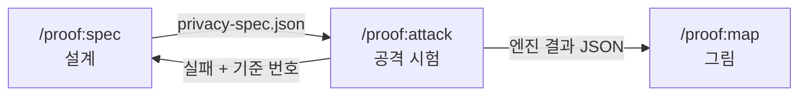

# Midnight Proof Kit

> 상태: 초기 개발 중 (early development). "(계획)" 표시가 붙은 기능은 아직 없습니다.

## 한국어

Midnight Proof Kit은 Compact 계약을 로컬에서 실제로 실행해 확인하는 Claude Code 플러그인이자 TypeScript 시험 엔진입니다. 다음 두 가지를 공격 시험으로 확인합니다.
- 숨기려던 값이 체인에서 정말 숨겨지는가
- 회로가 사용자가 준 값을 제대로 묶어 두는가

판정은 실행 결과로만 합니다. LLM은 판정하지 않습니다.

### 왜 만드나 (개발 동기)

이 프로젝트를 시작한 사람은 Midnight 앱을 처음 만들면서 이런 일을 겪었습니다.
- 회로 설계가 맞는지, 숨긴 값이 정말 숨겨지는지를 LLM 검토에만 기댔습니다.
- LLM의 코드 읽기 검토(midnight-expert 보안 검토 프로필)는 가장 심각한 결함을 읽어 내긴 했지만 확정하지 못했습니다. 한 회로가 같은 비밀 witness를 두 번 읽어서, 중복 신청 방지가 뚫리는 결함이었습니다.
- 정직한 값으로만 돌린 시험은 모두 통과했습니다.

이 결함은 실제로 실행해 봐야 확정됩니다. 기존 도구에는 그 자리가 비어 있습니다.
- **Compact 컴파일러**는 `disclose()` 없이 숨긴 값을 공개하는 코드를 막습니다. 하지만 커밋은 상수 소금이어도 `disclose()` 없이 통과시키고, 해시는 `disclose()`만 붙이면 경우의 수가 작은 값이어도 통과시킵니다. 또 컴파일러가 `disclose()`를 요구할 때 그대로 감싸면 컴파일은 되지만 값이 공개됩니다(예: 숨긴 구매 시각을 비교하는 `blockTimeGte`, 시나리오 car-club 구멍 판).
- **midnight-expert의 `/audit-compact`**는 LLM이 코드를 읽어 의심 가는 곳을 찾습니다. 개인정보 항목은 대부분 리뷰 판단으로 남습니다.

그 개발 기록을 Midnight를 처음 쓰는 사람의 입장에서 일반화한 것이 이 도구의 기준입니다([처음 만들 때 생기는 일](docs/design-guide/lessons-first-build.md)). 아직 한 사람의 기록에서 나온 기준이라, 실제 레포 측정으로 넓혀 갈 예정입니다.

| 일반화 기준 | 도구에서 하는 일 |
| --- | --- |
| "보여 준다"에는 청중이 셋이다: 누구나 / 한 검증자에게만 / 본인만 | 설계 단계에서 값마다 정합니다. "검증자에게만"인 값은 그 값의 커밋이나 해시가 체인에 남는지 엔진이 확인합니다 |
| 증명이 보장하지 않는 것을 먼저 적는다: 입력이 현실에서 있었는지, 빠짐없이 냈는지, 사본이 지워졌는지 | 설계안의 누출 설명에 함께 적습니다 |
| 사용자가 말하지 않은 정보도 샌다: 기록 수, 진행 상태, 배포 단위 | 정보 목록에서 따로 묻습니다 |
| "한 번만"의 단위를 정한다 | nullifier에 그 단위(회차, 기간)를 넣는 패턴을 안내합니다 |
| 비밀 witness는 한 호출에서 한 번만 읽는다 | 공격 T2가 실행으로 확인합니다 |
| 결과를 받아 커밋만 하지 말고, 회로 안에서 다시 계산한다 | 설계 패턴으로 안내합니다 |
| 정직한 값으로만 돌린 시험은 악의적인 입력을 못 잡는다 | 엔진은 입력을 바꿔 가며 실행합니다 |
| "통과"는 어느 단계의 통과인지 밝힌다 | 엔진은 컴파일된 회로의 실행 단계이고, 증명 서버·체인·지갑 단계는 아니라고 밝힙니다 |

**누구를 위한가**: 처음 Midnight를 쓰는 개발자(해커톤 참가자 포함)와, 제출물을 보는 심사위원·멘토.

### 세 기능은 한 흐름이다



1. **`/proof:spec`: 회로 설계.** 한 줄 아이디어에서 상황을 기획합니다. 그다음 정보 목록(말하지 않은 정보 포함), 네 질문, 설계안 다섯 부분, 누출 설명(`privacy-spec.json`)까지 사용자와 함께 만듭니다. 설계 기준은 12개입니다. 시험이 실패하면 어긴 기준과 고칠 패턴을 알려 줍니다.
2. **`/proof:attack`: 공격 시험.** 컴파일된 계약을 설정 없이 실행합니다.
   - 시작 상태를 스스로 찾습니다. 생성자 인자 맞추기, 회로 두 개까지 먼저 부르기, witness 사이의 관계 맞추기를 합니다.
   - 숨긴 입력을 바꿔 가며 체인에 남는 것을 비교합니다.
3. **`/proof:map`: 그림.** 엔진 결과로 "숨긴 값 → 회로 → 체인에 남는 것" Mermaid 그림을 칠합니다. 구멍 판과 고친 판을 나란히 그릴 수 있습니다. 예: [건강 정보 예제 그림](docs/design-guide/map-health-credential.md).

### 공격

| 공격 | 하는 일 | 상태 |
| --- | --- | --- |
| A1 노출 | 숨긴 입력 하나만 바꿔 여러 번 실행하고, 체인에 남는 기록과 장부를 비교합니다. 반환값은 호출자에게만 가므로 따로 표시하고 실패로 세지 않습니다 | 동작 |
| A2 역산 | 숨긴 입력에 묶인 공개 값이 있으면 후보를 대입해 원래 값을 되찾습니다. 범위가 작으면 전부, 크면 예산(기본 12,000개)까지 대입하고, 키·소금처럼 경우의 수가 큰 값은 시도하지 않습니다 | 동작 |
| A5 경로 | 숨긴 입력에 따라 건드리는 장부 칸이나 연산 순서가 달라지는지 봅니다 | 동작 |
| T2 분할 witness | 한 호출에서 같은 witness를 같은 인자로 여러 번 읽는 회로에, 읽을 때마다 다른 값을 줘도 통과하는지 봅니다(`UNBOUND`, 기준 10) | 동작 |
| A3 연결 | 같은 사용자의 두 행동이 공개 값으로 이어지는지 봅니다 | 계획 |
| A4 차분·집계, A6 재조합 | 집계 전후 비교, 공개 항목의 조합으로 사람을 특정합니다 | 계획 |

나머지 보증 공격(사칭, 그 밖의 거짓 witness, 호출자가 주는 시각)은 midnight-expert와 겹쳐 범위에서 뺐습니다.

### 판정 규칙

**실패의 기준.** 누출 설명(`privacy-spec.json`)에 없는 것이 체인에 드러나면 실패입니다.
- 누출 설명이 없을 때: 직접 `disclose()`한 것은 "선언된 공개"로 봅니다. 해시나 커밋을 거쳐 풀리는 것만 실패입니다. 컴파일러가 숨겨진다고 믿고 통과시킨 경우이기 때문입니다.
- 엔진은 실행 중 해시·커밋 함수의 출력을 기록합니다. 이 기록으로 달라진 공개 값이 해시·커밋을 거쳐 나온 것인지 구분합니다.

**T2 실패.** T2 실패는 누출 설명으로 허용할 수 없습니다.

**검증자에게만.** 누출 설명의 숨김 항목에 `shareWith`(그 값을 받는 쪽)를 적을 수 있습니다.
- 그 쪽은 장부 밖에서 opening(값 + nonce)을 받아, 체인의 커밋과 대조해 값을 확인합니다.
- 엔진은 그 값의 커밋이나 해시가 체인에 남는지 실행 결과로 확인합니다. 받는 쪽이 opening으로 다시 계산할 수 있는지까지는 보지 않습니다. 이 확인은 실패 수와 따로 셉니다.

**통과의 뜻.** "이 공격 목록에서 재현되지 않음"이지 "안전함"이 아닙니다. 결과 종류와 그림 색의 뜻은 [verdicts.md](plugins/proof-kit/skills/proof-attack/references/verdicts.md)에 있습니다.

### 예제와 정답표

`bench/scenarios/`에 직접 만든 구멍 판 / 고친 판 8쌍이 있습니다. 시험이 정답표(`answer.json`)와 자동으로 대조합니다. 엔진 작성자가 만든 예제라 회귀 시험 역할이고, 탐지력의 근거는 실제 레포 측정에서 나와야 합니다.
- 건강 정보 자격 증명
- 해시로 숨긴 건강 정보
- 상수 소금
- 사실만 공개
- 투표 경로
- 차 동호회
- 장학금
- 분할 witness

따라 하기 문서:
- [건강 정보](docs/design-guide/walkthrough-health-credential.md): 사용자와 주고받는 1~5단계를 끝까지
- [차 동호회](docs/design-guide/walkthrough-car-club.md), [장학금](docs/design-guide/walkthrough-scholarship.md): 한 줄 입력에서 스킬이 상황을 기획해 설계까지

컴파일러 0.36.0의 동작은 실험 계약 40개로 확인했습니다([compiler-probe](docs/design-guide/compiler-probe/)).

### 엔진 단독 실행

엔진은 아직 npm에 올리지 않았으니 이 레포에서 빌드해 씁니다. Node 22 이상과 Compact 컴파일러 0.36.0이 필요합니다. `compact update`가 GitHub API 한도로 실패하면 [릴리스 파일](https://github.com/midnightntwrk/compact/releases/tag/compactc-v0.36.0)을 직접 받으세요.

```bash
cd packages/proof-kit && npm install && npm run build && cd ../..
compact compile --skip-zk src/my.compact managed/my
node packages/proof-kit/dist/cli.js attack managed/my                       # 사람이 읽는 보고서
node packages/proof-kit/dist/cli.js attack managed/my --spec privacy-spec.json --json
node packages/proof-kit/dist/cli.js map managed/holed managed/fixed --spec privacy-spec.json --out map.md
```

**런타임.** 엔진은 계약 프로젝트의 `@midnight-ntwrk/compact-runtime`을 먼저 쓰고, 없으면 엔진에 든 사본을 씁니다. 버전을 맞추려면 계약 프로젝트에 설치해 두기를 권합니다.

**종료 코드.** `attack`은 실패가 없으면 0, 있으면 1, 사용법·불러오기 오류면 2입니다. `map`은 그림을 만들면 0입니다(실패가 있어도). 따로 `--help`는 없고, 잘못 부르면 사용법을 출력합니다.

**엔진 개발용 명령.** 컴파일러 경로를 넘겨 픽스처를 컴파일한 뒤 시험합니다.

```bash
cd packages/proof-kit && npm install && COMPACTC=<compactc 경로> npm run fixtures && npm test
```

**플러그인 설치** (계획, Claude Code):

```bash
claude plugin marketplace add THISISMYCOSMOS/krnightforce
```

### 범위 밖

- 수수료 주소, 비차폐 토큰, 네트워크 정보, 지갑과 증명 서버는 다루지 않습니다.
- 증명을 외부 증명 서버에서 만들면 숨긴 값이 그 서버로 전달됩니다. 이때의 보호는 그 서버의 신뢰 실행 환경(TEE)에 달려 있습니다. 이 시험은 체인에 남는 정보만 봅니다.

### 문서 지도

| 문서 | 내용 |
| --- | --- |
| [docs/plan.md](docs/plan.md) | 기획, 결정 기록, 진행 상황, 다음 작업, 미결정. 기획의 기준 |
| [docs/HANDOFF.md](docs/HANDOFF.md) | 다음 작업자를 위한 인계: 지금 상태, 환경, 답을 기다리는 결정 |
| [docs/design-guide.md](docs/design-guide.md) | 설계 가이드(Kachina 틀, 설계 기준 12개) |
| [docs/design-guide/lessons-first-build.md](docs/design-guide/lessons-first-build.md) | 개발 동기: 첫 구축 기록에서 일반화한 교훈 13개 |
| [docs/faq-beyond-llm.md](docs/faq-beyond-llm.md) | Midnight를 모르는 일반 LLM이 못 만드는 부분 |
| `plugins/proof-kit/skills/` | 세 스킬(`proof-spec`, `proof-attack`, `proof-map`)과 참고 문서 |
| `packages/proof-kit/` | 엔진과 CLI |
| `bench/` | 시나리오 쌍과 정답표 형식 |

## English

Midnight Proof Kit is a Claude Code plugin and TypeScript test engine that runs compiled Compact contracts locally and checks, by attack tests, whether values meant to stay hidden really stay hidden on chain, and whether a circuit binds the values the user supplies. Verdicts come only from execution, never from an LLM's judgment.

**Why.** The project started from its author's first Midnight build. Whether the circuits were right, and whether hidden values stayed hidden, rested on LLM review. That review spotted the most serious flaw but could not confirm it: a circuit read the same secret witness twice, which broke the duplicate-claim check. Tests run with honest values all passed. The Compact compiler lets a constant-salt commitment through without `disclose()`, and a hash of a small value through once it is wrapped in `disclose()`. midnight-expert's `/audit-compact` leaves most privacy items to review judgment. Proof Kit generalizes that build log into criteria for first-time builders ([lessons, Korean](docs/design-guide/lessons-first-build.md)) and checks them by execution.

**Three features, one flow.**
- `/proof:spec` designs the circuit from a one-line idea and writes the leakage description (`privacy-spec.json`).
- `/proof:attack` runs the engine against the compiled contract with zero configuration.
- `/proof:map` draws "hidden value → circuit → what lands on chain" as Mermaid, holed and fixed side by side.

**Attacks.**
- Working:
  - A1 exposure
  - A2 recovery
  - A5 path
  - T2 split witness: a witness read more than once with the same arguments in one call still passes when the reads get different values.
- Planned: A3 linking, A4 differencing, A6 recombination.
- Other assurance attacks are out of scope (midnight-expert covers them).

**Verdicts.**
- Anything outside the leakage description that lands on chain fails.
- Without a description, only values recovered through a hash or commitment fail.
- A `hidden` entry may name `shareWith`, a party that receives the opening off chain. The engine checks, from execution, that a commitment or hash of that value lands on chain, and reports this check apart from the failure count. It does not check that the party can recompute it from the opening.
- A pass means "not reproduced by this attack list", not "safe".

Eight self-written holed/fixed scenario pairs in `bench/scenarios/` are checked against answer keys. Plan and status: [docs/plan.md](docs/plan.md). Handoff: [docs/HANDOFF.md](docs/HANDOFF.md).

Out of scope: fee addresses, unshielded tokens, network metadata, wallets and proving servers. When proofs are generated on an external proving server, the hidden values are sent to that server, and their protection depends on that server's trusted execution environment.

## License

Apache-2.0. See [LICENSE](LICENSE).
