# 갈림길 비교: A: 블록 시각과 비교 / B: 공개 동호회 달과 비교

같은 누출 설명(사용)으로 두 안을 실행해 공격한 결과입니다. 색은 엔진 보고서에서만 가져오며, 어느 안이 낫다는 판단은 하지 않습니다.

- **A: 블록 시각과 비교**: 실패 1건 · 시험한 입력 21개 · 시험 못 함 0개
- **B: 공개 동호회 달과 비교**: 실패 0건 · 시험한 입력 21개 · 시험 못 함 0개

## 무엇이 다른가

| 회로 | 입력 | A: 블록 시각과 비교 | B: 공개 동호회 달과 비교 |
| --- | --- | --- | --- |
| proveHeldYear | witness:purchase_month | 위험 (A2 recoverable) | 증명만 (A1 masked) |

## A: 블록 시각과 비교

```mermaid
flowchart LR
  subgraph a_in["숨긴 값"]
    a_i0_arg_id["arg:id"]:::public
    a_i1_witness_operator_secret["witness:operator_secret"]:::proof
    a_i2_witness_car_model["witness:car_model"]:::public
    a_i3_witness_purchase_month["witness:purchase_month"]:::risk
    a_i4_witness_plate_number["witness:plate_number<br/>검증자: operator"]:::proof
    a_i5_witness_owner_key["witness:owner_key"]:::proof
    a_i6_witness_car_nonce["witness:car_nonce"]:::proof
    a_i7_arg_m["arg:m"]:::public
    a_i8_witness_owner_secret["witness:owner_secret"]:::proof
  end
  subgraph a_c["회로"]
    a_c9_registerCar["registerCar"]
    a_c10_setMonth["setMonth"]
    a_c11_showCar["showCar"]
    a_c12_proveHeldYear["proveHeldYear"]
  end
  subgraph a_o["체인에 남는 것"]
    a_o13_registerCar_arg_id["id: 공개<br/>누출 설명이 허용: A1 exposed"]:::public
    a_o14_registerCar_witness_operator_secret["operator_secret: 증명만<br/>A1 tag"]:::proof
    a_o15_registerCar_witness_car_model["car_model: 증명만<br/>A1 masked"]:::proof
    a_o16_registerCar_witness_purchase_month["purchase_month: 증명만<br/>A1 masked"]:::proof
    a_o17_registerCar_witness_plate_number["plate_number: 증명만<br/>A1 masked"]:::proof
    a_o18_registerCar_witness_owner_key["owner_key: 증명만<br/>A1 masked"]:::proof
    a_o19_registerCar_witness_car_nonce["car_nonce: 증명만<br/>A1 masked"]:::proof
    a_o20_setMonth_arg_m["m: 공개<br/>누출 설명이 허용: A1 exposed"]:::public
    a_o21_setMonth_witness_operator_secret["operator_secret: 증명만<br/>A1 tag"]:::proof
    a_o22_showCar_arg_id["id: 공개<br/>누출 설명이 허용: A1 exposed, A5 exposed"]:::public
    a_o23_showCar_witness_car_model["car_model: 공개<br/>누출 설명이 허용: A1 exposed"]:::public
    a_o24_showCar_witness_purchase_month["purchase_month: 증명만<br/>A1 masked"]:::proof
    a_o25_showCar_witness_plate_number["plate_number: 증명만<br/>A1 masked"]:::proof
    a_o26_showCar_witness_owner_secret["owner_secret: 증명만<br/>A1 masked"]:::proof
    a_o27_showCar_witness_car_nonce["car_nonce: 증명만<br/>A1 masked"]:::proof
    a_o28_proveHeldYear_arg_id["id: 공개<br/>누출 설명이 허용: A1 exposed, A5 exposed"]:::public
    a_o29_proveHeldYear_witness_car_model["car_model: 증명만<br/>A1 masked"]:::proof
    a_o30_proveHeldYear_witness_purchase_month["purchase_month: 위험<br/>A2 recoverable"]:::risk
    a_o31_proveHeldYear_witness_plate_number["plate_number: 증명만<br/>A1 masked"]:::proof
    a_o32_proveHeldYear_witness_owner_secret["owner_secret: 증명만<br/>A1 masked"]:::proof
    a_o33_proveHeldYear_witness_car_nonce["car_nonce: 증명만<br/>A1 masked"]:::proof
  end
  a_i0_arg_id --> a_c9_registerCar --> a_o13_registerCar_arg_id
  a_i1_witness_operator_secret --> a_c9_registerCar --> a_o14_registerCar_witness_operator_secret
  a_i2_witness_car_model --> a_c9_registerCar --> a_o15_registerCar_witness_car_model
  a_i3_witness_purchase_month --> a_c9_registerCar --> a_o16_registerCar_witness_purchase_month
  a_i4_witness_plate_number --> a_c9_registerCar --> a_o17_registerCar_witness_plate_number
  a_i5_witness_owner_key --> a_c9_registerCar --> a_o18_registerCar_witness_owner_key
  a_i6_witness_car_nonce --> a_c9_registerCar --> a_o19_registerCar_witness_car_nonce
  a_i7_arg_m --> a_c10_setMonth --> a_o20_setMonth_arg_m
  a_i1_witness_operator_secret --> a_c10_setMonth --> a_o21_setMonth_witness_operator_secret
  a_i0_arg_id --> a_c11_showCar --> a_o22_showCar_arg_id
  a_i2_witness_car_model --> a_c11_showCar --> a_o23_showCar_witness_car_model
  a_i3_witness_purchase_month --> a_c11_showCar --> a_o24_showCar_witness_purchase_month
  a_i4_witness_plate_number --> a_c11_showCar --> a_o25_showCar_witness_plate_number
  a_i8_witness_owner_secret --> a_c11_showCar --> a_o26_showCar_witness_owner_secret
  a_i6_witness_car_nonce --> a_c11_showCar --> a_o27_showCar_witness_car_nonce
  a_i0_arg_id --> a_c12_proveHeldYear --> a_o28_proveHeldYear_arg_id
  a_i2_witness_car_model --> a_c12_proveHeldYear --> a_o29_proveHeldYear_witness_car_model
  a_i3_witness_purchase_month --> a_c12_proveHeldYear --> a_o30_proveHeldYear_witness_purchase_month
  a_i4_witness_plate_number --> a_c12_proveHeldYear --> a_o31_proveHeldYear_witness_plate_number
  a_i8_witness_owner_secret --> a_c12_proveHeldYear --> a_o32_proveHeldYear_witness_owner_secret
  a_i6_witness_car_nonce --> a_c12_proveHeldYear --> a_o33_proveHeldYear_witness_car_nonce
  classDef hidden fill:#d9f2e0,stroke:#2e7d4f,color:#123
  classDef proof fill:#dce8fa,stroke:#2f5fa7,color:#123
  classDef public fill:#fff1c2,stroke:#a07800,color:#321
  classDef risk fill:#fbd5d5,stroke:#b42318,color:#300,stroke-width:2px
  classDef untested fill:#e6e6e6,stroke:#777,color:#333,stroke-dasharray:4 3
```

## B: 공개 동호회 달과 비교

```mermaid
flowchart LR
  subgraph b_in["숨긴 값"]
    b_i0_arg_id["arg:id"]:::public
    b_i1_witness_operator_secret["witness:operator_secret"]:::proof
    b_i2_witness_car_model["witness:car_model"]:::public
    b_i3_witness_purchase_month["witness:purchase_month"]:::proof
    b_i4_witness_plate_number["witness:plate_number<br/>검증자: operator"]:::proof
    b_i5_witness_owner_key["witness:owner_key"]:::proof
    b_i6_witness_car_nonce["witness:car_nonce"]:::proof
    b_i7_arg_m["arg:m"]:::public
    b_i8_witness_owner_secret["witness:owner_secret"]:::proof
  end
  subgraph b_c["회로"]
    b_c9_registerCar["registerCar"]
    b_c10_setMonth["setMonth"]
    b_c11_showCar["showCar"]
    b_c12_proveHeldYear["proveHeldYear"]
  end
  subgraph b_o["체인에 남는 것"]
    b_o13_registerCar_arg_id["id: 공개<br/>누출 설명이 허용: A1 exposed"]:::public
    b_o14_registerCar_witness_operator_secret["operator_secret: 증명만<br/>A1 tag"]:::proof
    b_o15_registerCar_witness_car_model["car_model: 증명만<br/>A1 masked"]:::proof
    b_o16_registerCar_witness_purchase_month["purchase_month: 증명만<br/>A1 masked"]:::proof
    b_o17_registerCar_witness_plate_number["plate_number: 증명만<br/>A1 masked"]:::proof
    b_o18_registerCar_witness_owner_key["owner_key: 증명만<br/>A1 masked"]:::proof
    b_o19_registerCar_witness_car_nonce["car_nonce: 증명만<br/>A1 masked"]:::proof
    b_o20_setMonth_arg_m["m: 공개<br/>누출 설명이 허용: A1 exposed"]:::public
    b_o21_setMonth_witness_operator_secret["operator_secret: 증명만<br/>A1 tag"]:::proof
    b_o22_showCar_arg_id["id: 공개<br/>누출 설명이 허용: A1 exposed, A5 exposed"]:::public
    b_o23_showCar_witness_car_model["car_model: 공개<br/>누출 설명이 허용: A1 exposed"]:::public
    b_o24_showCar_witness_purchase_month["purchase_month: 증명만<br/>A1 masked"]:::proof
    b_o25_showCar_witness_plate_number["plate_number: 증명만<br/>A1 masked"]:::proof
    b_o26_showCar_witness_owner_secret["owner_secret: 증명만<br/>A1 masked"]:::proof
    b_o27_showCar_witness_car_nonce["car_nonce: 증명만<br/>A1 masked"]:::proof
    b_o28_proveHeldYear_arg_id["id: 공개<br/>누출 설명이 허용: A1 exposed, A5 exposed"]:::public
    b_o29_proveHeldYear_witness_car_model["car_model: 증명만<br/>A1 masked"]:::proof
    b_o30_proveHeldYear_witness_purchase_month["purchase_month: 증명만<br/>A1 masked"]:::proof
    b_o31_proveHeldYear_witness_plate_number["plate_number: 증명만<br/>A1 masked"]:::proof
    b_o32_proveHeldYear_witness_owner_secret["owner_secret: 증명만<br/>A1 masked"]:::proof
    b_o33_proveHeldYear_witness_car_nonce["car_nonce: 증명만<br/>A1 masked"]:::proof
  end
  b_i0_arg_id --> b_c9_registerCar --> b_o13_registerCar_arg_id
  b_i1_witness_operator_secret --> b_c9_registerCar --> b_o14_registerCar_witness_operator_secret
  b_i2_witness_car_model --> b_c9_registerCar --> b_o15_registerCar_witness_car_model
  b_i3_witness_purchase_month --> b_c9_registerCar --> b_o16_registerCar_witness_purchase_month
  b_i4_witness_plate_number --> b_c9_registerCar --> b_o17_registerCar_witness_plate_number
  b_i5_witness_owner_key --> b_c9_registerCar --> b_o18_registerCar_witness_owner_key
  b_i6_witness_car_nonce --> b_c9_registerCar --> b_o19_registerCar_witness_car_nonce
  b_i7_arg_m --> b_c10_setMonth --> b_o20_setMonth_arg_m
  b_i1_witness_operator_secret --> b_c10_setMonth --> b_o21_setMonth_witness_operator_secret
  b_i0_arg_id --> b_c11_showCar --> b_o22_showCar_arg_id
  b_i2_witness_car_model --> b_c11_showCar --> b_o23_showCar_witness_car_model
  b_i3_witness_purchase_month --> b_c11_showCar --> b_o24_showCar_witness_purchase_month
  b_i4_witness_plate_number --> b_c11_showCar --> b_o25_showCar_witness_plate_number
  b_i8_witness_owner_secret --> b_c11_showCar --> b_o26_showCar_witness_owner_secret
  b_i6_witness_car_nonce --> b_c11_showCar --> b_o27_showCar_witness_car_nonce
  b_i0_arg_id --> b_c12_proveHeldYear --> b_o28_proveHeldYear_arg_id
  b_i2_witness_car_model --> b_c12_proveHeldYear --> b_o29_proveHeldYear_witness_car_model
  b_i3_witness_purchase_month --> b_c12_proveHeldYear --> b_o30_proveHeldYear_witness_purchase_month
  b_i4_witness_plate_number --> b_c12_proveHeldYear --> b_o31_proveHeldYear_witness_plate_number
  b_i8_witness_owner_secret --> b_c12_proveHeldYear --> b_o32_proveHeldYear_witness_owner_secret
  b_i6_witness_car_nonce --> b_c12_proveHeldYear --> b_o33_proveHeldYear_witness_car_nonce
  classDef hidden fill:#d9f2e0,stroke:#2e7d4f,color:#123
  classDef proof fill:#dce8fa,stroke:#2f5fa7,color:#123
  classDef public fill:#fff1c2,stroke:#a07800,color:#321
  classDef risk fill:#fbd5d5,stroke:#b42318,color:#300,stroke-width:2px
  classDef untested fill:#e6e6e6,stroke:#777,color:#333,stroke-dasharray:4 3
```

통과는 "이 공격 목록으로 재현되지 않음"이지 안전하다는 뜻이 아닙니다. 색의 뜻은 `proofkit map`의 범례와 같습니다.
