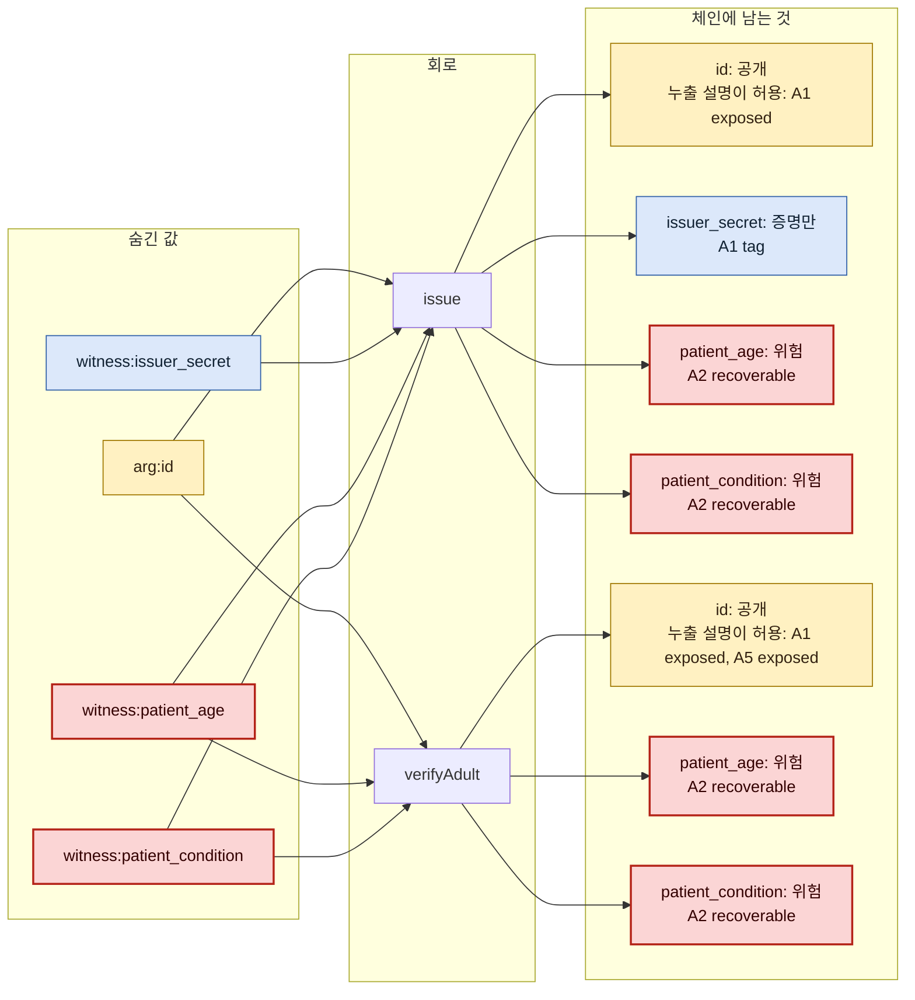
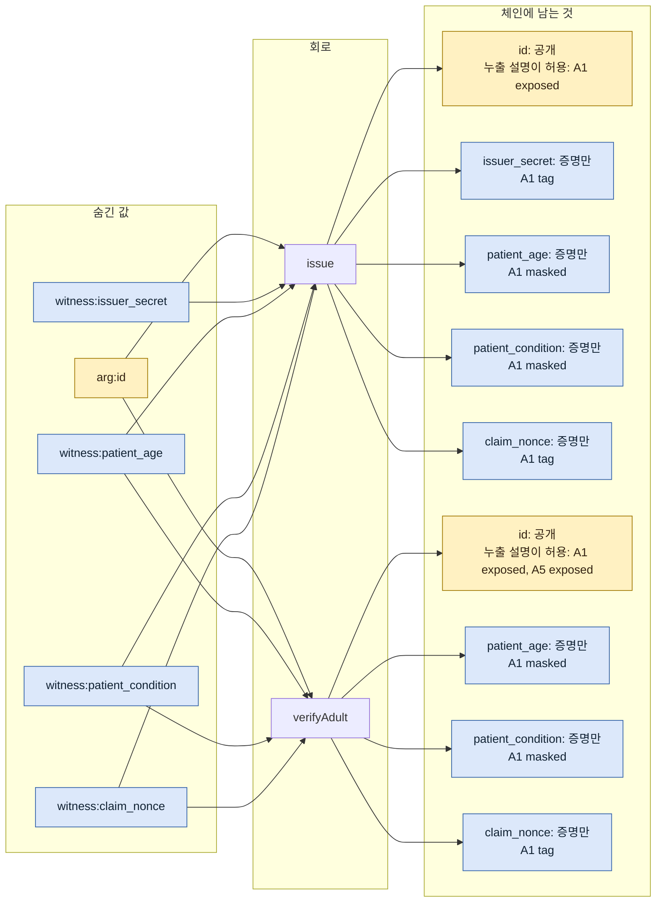

# 건강 정보 자격 증명: 프라이버시 지도

숨긴 값 → 회로 → 체인에 남는 것. 색은 `proofkit attack` 보고서에서만 가져옵니다.

## 구멍 판

실패 4건 · 시험한 입력 7개 · 시험 못 함 0개 · 누출 설명 사용

## 고친 판

실패 0건 · 시험한 입력 9개 · 시험 못 함 0개 · 누출 설명 사용

## 범례

| 색 | 뜻 (엔진 보고서의 어느 칸에서 오는가) |
| --- | --- |
| 숨김 | 값을 바꿔도 체인에 남는 것이 달라지지 않음 |
| 증명만 | 체인에 남지만 nonce·비밀로 가려짐 (`MASKED`, `TAG`) |
| 공개 | 드러나지만 누출 설명이 허용했거나 코드가 `disclose()`로 선언함 (`disclosure`) |
| 위험 | 실패 (`failure: true`: `EXPOSED`, `RECOVERABLE`, `PARTIAL`, `UNBOUND`) |
| 시험 못 함 | 엔진이 돌리지 못함 (`untestable`). 통과가 아님 |

한 값이 여러 회로에 쓰이면, 왼쪽 칸의 색은 가장 나쁜 결과(위험 > 시험 못 함 > 공개 > 증명만 > 숨김)를 따릅니다. 통과는 "이 공격 목록으로 재현되지 않음"이지 안전하다는 뜻이 아닙니다.
